# Communities — User Guide

Communities is a place for a group of people to govern themselves together — collaborate, manage shared money, run projects, and build agreements — without a company or admin in the middle. Everything you do here happens directly between you and the other members.

This guide walks through everything you can do in the app, tab by tab. Screenshots are from the mobile app, so each one is paired with its description in a column to the side of it.

---

## Table of Contents

1. [Key Concepts](#1-key-concepts)
2. [Logging In](#2-logging-in)
3. [Your Profile](#3-your-profile)
4. [Communities](#4-communities)
5. [Joining a Community](#5-joining-a-community)
6. [Inside a Community](#6-inside-a-community)
7. [Collaborations: Initiatives, Wishes, and Agreements](#7-collaborations-initiatives-wishes-and-agreements)
8. [Collaboration Tools (Flows)](#8-collaboration-tools-flows)
9. [Money: Policies and Wallet](#9-money-policies-and-wallet)
10. [Staying in Sync](#10-staying-in-sync)
11. [Quick Reference](#11-quick-reference)

---

## 1. Key Concepts

Before diving in, a few ideas make everything else make sense:

- **Your identity lives on your node, protected by a passkey.** There's no username or password. You have an identity on a **node**, a server you choose (your own, or one you trust), and you confirm who you are with a **passkey** (your phone's or computer's fingerprint, face or PIN unlock).
- **Your data lives on the members' nodes, not on a central server.** Every community, collaboration and tool is a small program (a *contract*) kept on the nodes of the people who use it. No single company or database owns your community's information.
- **The app asks your node, and your node asks you.** The app never holds your keys. When it needs to do something new for you (create something, join something, read a community for the first time), your node opens its **approval page**, and you approve with your passkey. Once you've approved, the app can keep doing the same kind of thing without asking again.

You don't need to understand the technical details to use the app. Just know that "your node" is *where your data lives*, and "approve on your node" means *a window from your node asks you to confirm*.

---

## 2. Logging In

<table>
<tr>
<td width="240" valign="top">

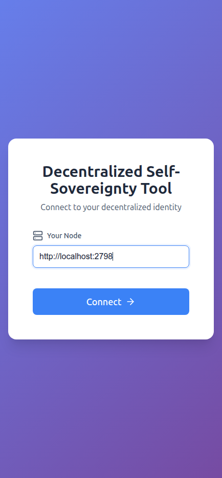

</td>
<td valign="top">

The login screen asks for one thing: **Your Node**, the address of your ibc node (for example `http://localhost:2611`). The app remembers nodes you've used before.

Click **Connect**. Your node's approval page opens: sign in with your passkey (or create your identity there, if this is your first time on that node), and approve connecting the app.

- Use the node's name, not an IP address: passkeys don't work at an IP address.
- The app stays logged in when you reload the page. If your node no longer knows the app (for example, you disconnected it on your node's page), you're back at the login screen and can connect again.

</td>
</tr>
</table>

---

## 3. Your Profile

<table>
<tr>
<td width="240" valign="top">

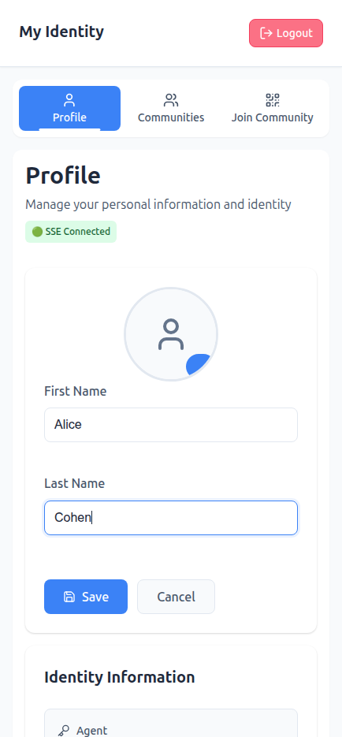

</td>
<td valign="top">

The **Profile** tab (under "My Identity") is where you choose how others see you:

- The first time, click **Create my profile** and approve on your node.
- Your profile starts **private**: other members can't see your name and photo. Click **Make it public** (and approve) to let the members of your communities see them.
- Set your first and last name, and a profile photo (uploaded and automatically resized). Click **Edit Profile** to make changes, then **Save**.
- Your identity's address and your node's URL are shown read-only, with **Copy** buttons.

Changes show up for other members automatically; nobody needs to refresh.

</td>
</tr>
</table>

---

## 4. Communities

<table>
<tr>
<td width="240" valign="top">

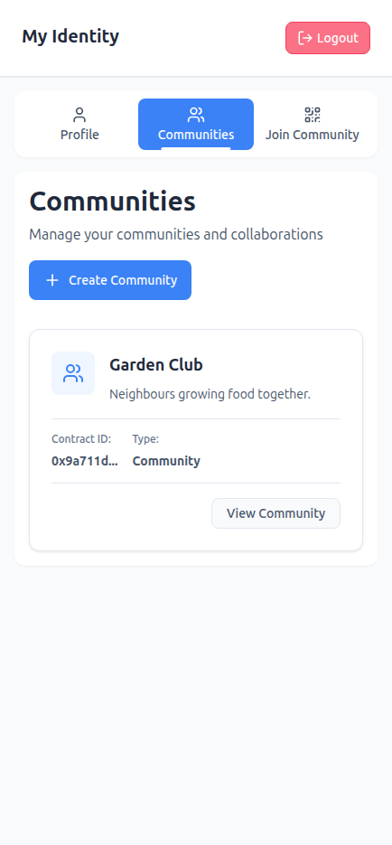

</td>
<td valign="top">

The **Communities** tab (under "My Identity") lists every community you belong to. From here you can:

- Open any community you're already in
- Click **Create Community** to start a new one

</td>
</tr>
</table>

### Creating a Community

<table>
<tr>
<td width="240" valign="top">

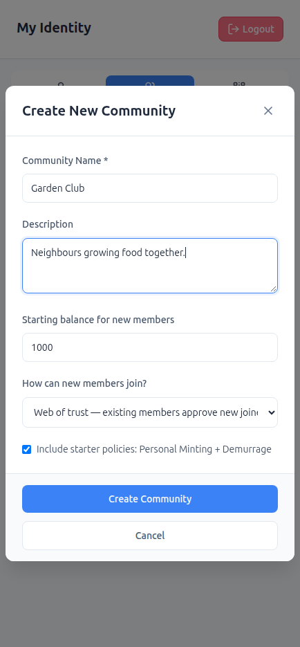

</td>
<td valign="top">

When you create a community, you choose:

- **Community Name** and **Description**
- **Starting balance for new members** — how much internal currency every new member receives when they join (defaults to 1000, but you can set any amount)
- **How can new members join?**
  - **Web of trust** — each new person and the members drawn as their vouchers approve each other (see [Becoming a member](#becoming-a-member))
  - **Open** — anyone with an invite can join instantly, no approval needed
- **Starter policies** — an optional checkbox that sets up two ready-made monetary policies for you: a "Personal Minting" policy (issues new currency to members) and a "Demurrage" policy (gradually reclaims a share of balances). You can always add, change, or remove policies later — see [Money: Policies and Wallet](#9-money-policies-and-wallet).

Click create, and approve on your node: the community is created on your node, with you as its first member. Then invite others from its **Share** tab.

</td>
</tr>
</table>

---

## 5. Joining a Community

<table>
<tr>
<td width="240" valign="top">

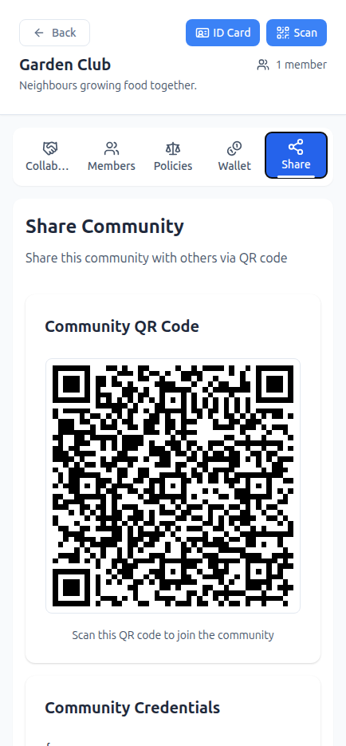

</td>
<td valign="top">

Someone already in the community needs to invite you. From their side, they open the community's **Share** tab, which shows a QR code and a block of text credentials.

</td>
</tr>
</table>

<table>
<tr>
<td width="240" valign="top">

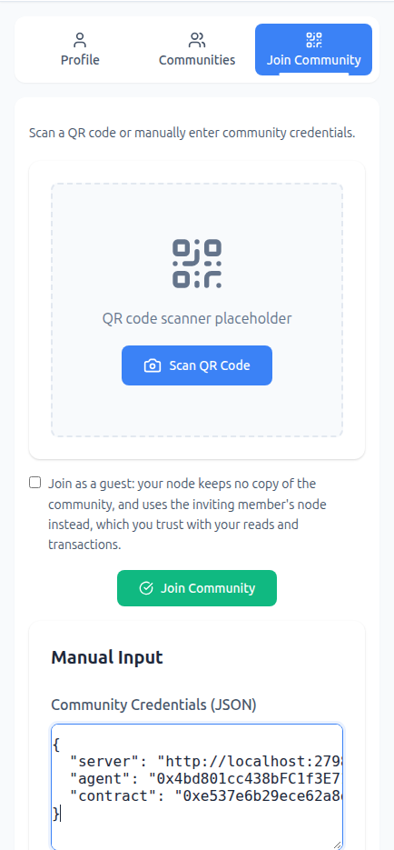

</td>
<td valign="top">

On your side, open the **Join Community** tab (under "My Identity"), and scan their QR code, or paste the credentials text under **Manual Input**. Then click **Join Community**, and approve on your node. This one approval does everything:

- Your node joins the community, through the inviting member's node.
- You let the app work with the community from now on, without asking each time.
- The app asks to make you a member, and opens the community's **Members** tab.

**Joining as a guest.** Before clicking Join, you can tick **Join as a guest**. Your node then keeps no copy of the community, and uses the inviting member's node instead. This is lighter for your node, but you trust that member's node with what you read and do in the community. Without it, your node keeps its own copy and takes part in keeping the community's records.

When your node joins, it checks that the community's program is the one it claims to be. If it couldn't check (for example, it couldn't prepare the tools to compare them), the app tells you, and you can still continue to the community.

</td>
</tr>
</table>

### Becoming a member

<table>
<tr>
<td width="240" valign="top">

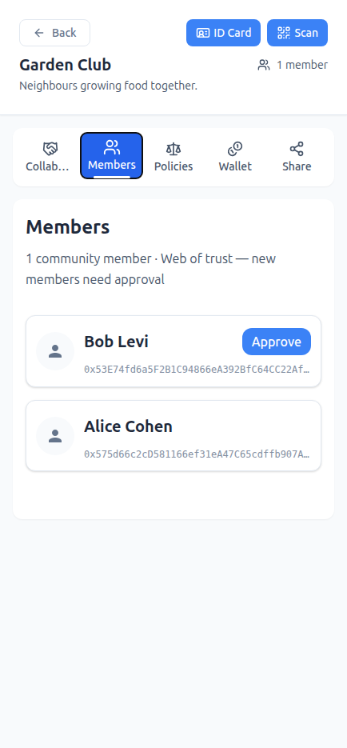

</td>
<td valign="top">

What happens next depends on how the community lets people in. The **Members** tab says which at the top.

- **Open membership:** you're a member right away.
- **Web of trust:** you're a **nominee**, and some members are drawn as your **vouchers**. You and each voucher approve each other: you approve each of them whom you know, and they approve you. Once all of you have approved each other, you're a member.
  - In a community of fewer than 5 members, every member is your voucher, and new people join one at a time.
  - In a larger community, you get 4 vouchers, drawn at random.
  - You or any of your vouchers can turn the request down, which cancels it.

If the app couldn't ask on its own, you'll see a **Become a Member** button (open communities) or an **Ask to Join** button (web of trust) on the Members tab instead.

When you're a voucher for someone, the Members tab shows them, with a button to approve or turn them down.

</td>
</tr>
</table>

---

## 6. Inside a Community

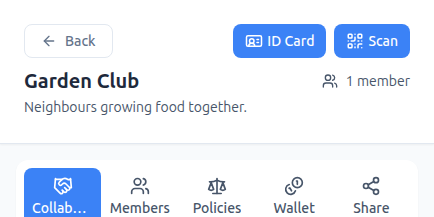

Once you're in a community, five tabs plus two header buttons give you everything you need:

- **Collaborations** — the community's projects, wishes, and agreements — see [section 7](#7-collaborations-initiatives-wishes-and-agreements).
- **Members** — everyone in the community, plus people asking to join and the approvals they need (see above).
- **Policies** — the community's shared monetary rules — see [section 9](#9-money-policies-and-wallet).
- **Wallet** — your personal balance and payments — see [section 9](#9-money-policies-and-wallet).
- **Share** — a QR code and credentials for inviting new people (see above).

Two buttons also live in the community header:

- **ID Card** — shows your own identity card and QR code *for this specific community*, so someone can quickly scan and recognize you.
- **Scan** — opens your camera to scan someone else's QR code (for example, to verify another member's ID card).

---

## 7. Collaborations: Initiatives, Wishes, and Agreements

<table>
<tr>
<td width="240" valign="top">

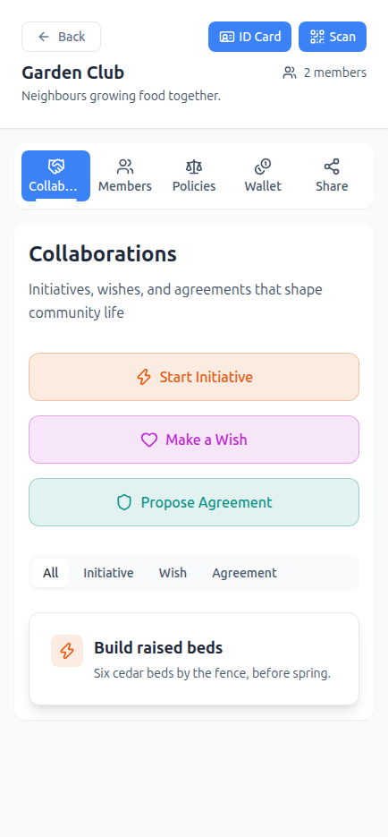

</td>
<td valign="top">

The **Collaborations** tab is where a community actually gets things done. Every item in the list is one of three types, created with its own button at the top of the tab:

- **⚡ Start Initiative** — a concrete project or effort the community is taking on. Give it a **Title** and a **Description** of the action.
- **♥ Make a Wish** — a lighter-weight way to float an idea before committing to it. Give it a **Title** and describe the **Dream / Need** behind it — what you're hoping for.
- **🛡 Propose Agreement** — a rule or commitment for the community. State the **Rule** itself and the **Protection** it provides — what harm or problem it prevents.

You can filter the list by type, and sort it.

</td>
</tr>
</table>

<table>
<tr>
<td width="240" valign="top">

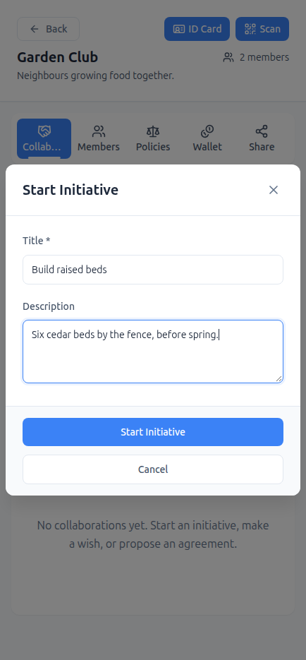

</td>
<td valign="top">

Creating one asks you to approve on your node: it's kept on your node, and listed in the community. If the app couldn't list it on its own, approve listing it when asked.

Click any card in the list to open it. The first time you open someone else's collaboration, click **Join** (and approve) to use it as a guest, through its creator's node. Every Initiative, Wish, and Agreement starts with nothing but a title; you build it out with **flows**.

</td>
</tr>
</table>

---

## 8. Collaboration Tools (Flows)

A collaboration holds **flows**: tools for voting, scheduling, tasks, discussion, and more. Each flow has a title, and flows can be nested: any flow can have flows under it, as deep as the work needs. For example, a "Venue" discussion can have a "Pick a date" scheduling flow under it.

<table>
<tr>
<td width="240" valign="top">

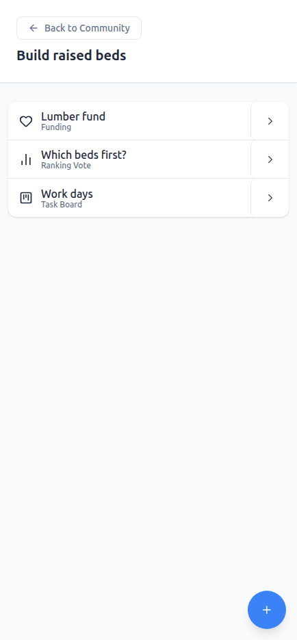

</td>
<td valign="top">

**Seeing the flows.** On a computer, the collaboration shows its whole tree of flows; click the arrow next to a flow to fold or unfold what's under it. On a phone, it shows one level at a time: tap the arrow next to a flow to see what's under it (the number tells how many flows are there), and use the breadcrumb (or your phone's back button) to go back up. Click a flow's title to open its page.

</td>
</tr>
</table>

<table>
<tr>
<td width="240" valign="top">

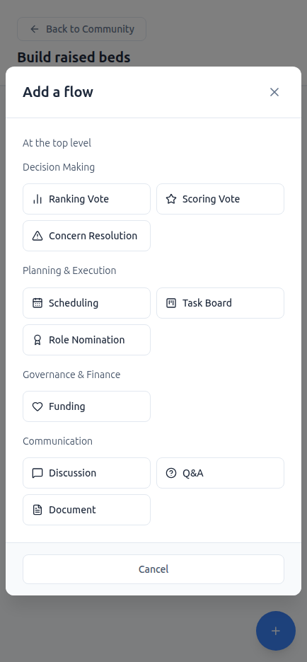

</td>
<td valign="top">

**Adding a flow.** Click **Add flow** (on a phone, the round **+** button), or the **+** next to a flow, to add one under it. Click the kind of flow you want. Its form opens: give the flow a title (the name it has in the collaboration's list), answer anything else the kind asks, and click its button (**Create**, or **Launch Fund** for a fund). Approve on your node: the flow is kept on your node. If the app couldn't add it to the collaboration on its own, a banner says the flow is created on your node, with an **Add it** button.

**Using someone else's flow.** The first time you open a flow someone else added, click **Join** (and approve) to use it as a guest, through their node.

</td>
</tr>
</table>

<table>
<tr>
<td width="240" valign="top">

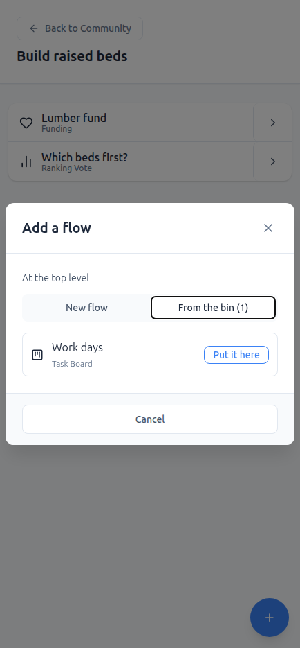

</td>
<td valign="top">

**The bin.** On a flow's page, **Move to bin** moves the flow, and everything under it, to the collaboration's bin. Only whoever added the flow, or the collaboration's creator, can do this. Nothing is deleted: in the **Add a flow** dialog, **From the bin** lists what's in it, and **Put it here** brings a flow back (with everything under it) to wherever you're adding.

</td>
</tr>
</table>

Flows are grouped into four categories, covered below.

### Decision Making

<table>
<tr>
<td width="240" valign="top">

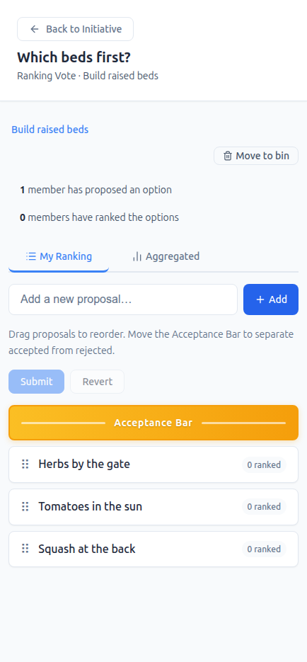

</td>
<td valign="top">

- **Ranking Vote** — members rank a list of options in their own order of preference; the app combines everyone's rankings into a group result.
- **Scoring Vote** — members give each option a personal score; scores are averaged into a group result.
- **Concern Resolution** — members raise concerns or objections, and others can add their support behind the ones that matter most to them, surfacing the concerns with the most backing.

</td>
</tr>
</table>

### Planning & Execution

<table>
<tr>
<td width="240" valign="top">

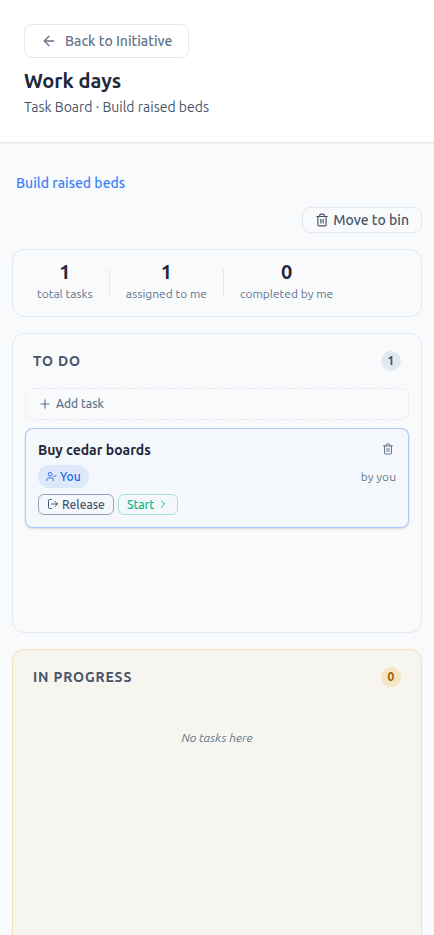

</td>
<td valign="top">

- **Scheduling** — propose a date/time range and let members mark their availability, useful for finding a time for a meeting or event.
- **Task Board** — a simple to-do / in-progress / done board. Tasks start in an "Unassigned" column until someone claims them.
- **Role Nomination** — propose a named role (e.g. "Treasurer") and let members nominate and approve or reject candidates for it.

</td>
</tr>
</table>

### Governance & Finance

<table>
<tr>
<td width="240" valign="top">

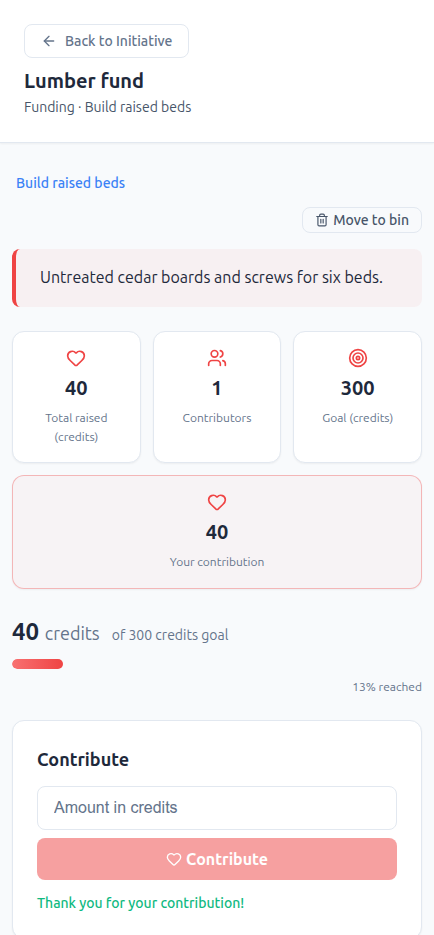

</td>
<td valign="top">

- **Funding** — set a fundraising goal and description, then track contributions toward it. The fund is an account in the community, so contributions are real payments from your Wallet. Participants also list budget items, and each splits 1000 points among them to show how the money should be spent.

</td>
</tr>
</table>

### Communication

- **Discussion** — an open, threaded comment area for general conversation.
- **Q&A** — members post questions, others post answers, and everyone can approve or disapprove answers.
- **Document** — a shared, living document. Each person edits what they wrote; others propose edits or deletions, which take effect once 3 people support them (or are dropped once 3 reject them). It can be downloaded as a PDF.

---

## 9. Money: Policies and Wallet

Every community has its own currency, governed jointly by its members through the **Policies** tab, and spent through the **Wallet** tab.

### How Policies work

<table>
<tr>
<td width="240" valign="top">

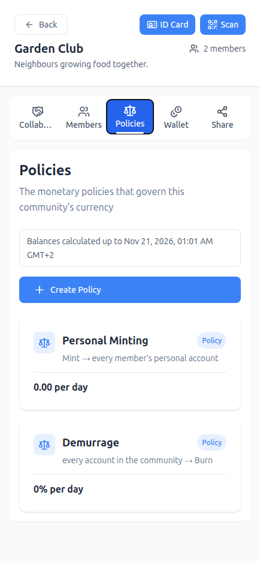

</td>
<td valign="top">

A policy is a rule that moves currency automatically, **once a day**. Every policy you create from this tab has:

- A **source** — where the money comes from: nowhere (newly created), a specific account, every member's personal account, or every account in the community
- A **destination** — where it goes: nowhere (destroyed), a specific account, every member's personal account, or every account
- A **mode** — either a fixed number of **units** per day, or a **percentage** of the source's balance per day

You don't set a rate when creating a policy. Every policy created here is **community-governed** — its actual rate comes from the members, not from a number you type in (see below for how).

Two starter policies are commonly used: **Personal Minting** (issues new currency into every member's account) and **Demurrage** (gradually reclaims a share of every balance, encouraging money to keep moving rather than sit idle).

</td>
</tr>
</table>

<table>
<tr>
<td width="240" valign="top">

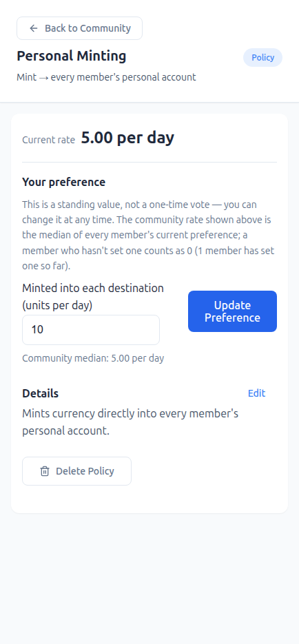

</td>
<td valign="top">

Open any policy to see its detail page. This is where you set **your own preference** for its rate — a standing input, not a one-time vote, which you can change any time.

The policy doesn't run on your number alone: it runs on the **median** of every member's preference. A member who hasn't set a preference counts as 0, so a policy only runs once more than half the members want it to. As people set or update their own preference, the median — and so the policy's actual rate — updates. The median is shown on the policy's card in the **Policies** tab, and at the top of its own detail page. A policy can't be deleted while its median rate is still above zero.

Personal commitments work differently — you set a fixed rate yourself, and it isn't governed by a median. They're created and managed from the **Wallet** tab, not from here (see below).

</td>
</tr>
</table>

### Balances are calculated up to a time

Policies apply day by day, and the community calculates everyone's balances up to a point in time. The Policies and Wallet tabs show **Balances calculated up to** that time. Click **Update balances** to bring them up to now. Payments and rate changes bring the balances up to date by themselves first, so they always use the correct amounts.

### How the Wallet works

<table>
<tr>
<td width="240" valign="top">

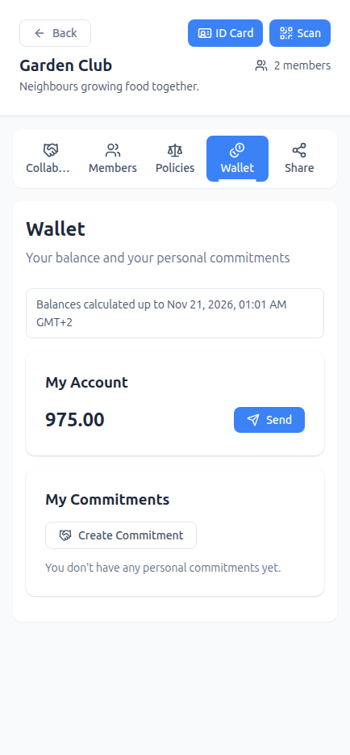

</td>
<td valign="top">

The **Wallet** tab is where you handle your own money:

- **My Account** shows your personal balance and a **Send** button for paying anyone — another member, or a fund — instantly.
- **My Commitments** lists the payments you've committed to from your own account, at a rate you set yourself, with a button to create a new one.

</td>
</tr>
</table>

<table>
<tr>
<td width="240" valign="top">

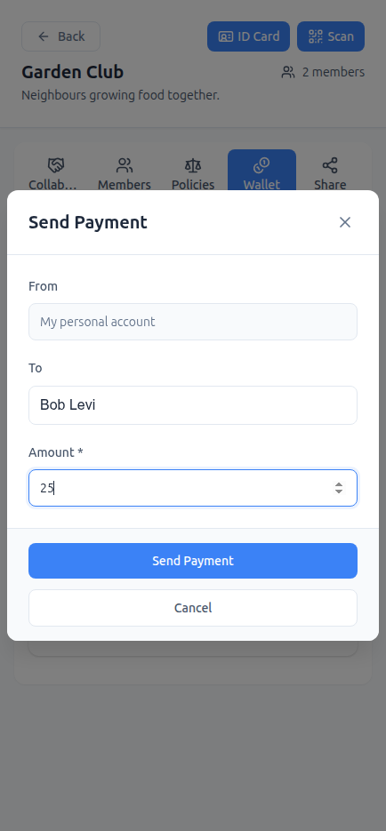

</td>
<td valign="top">

You'll see right away whether the payment completed or failed.

</td>
</tr>
</table>

---

## 10. Staying in Sync

You never need to manually refresh the app. Whenever anyone writes a change — a payment, a vote, a new comment, an approval — everyone else's screen updates automatically within moments, because the app keeps a live link to your node. The **SSE Connected** indicator on your profile shows that this link is active (**SSE Disconnected** when it is not); if it drops, the app reconnects by itself.

**Approving on your node.** When a button says **Approve on your node…**, a window from your node is waiting for you. If you don't see it, check whether your browser blocked the popup. When the app needs your permission for something it can't ask on its own, it shows a button instead (such as **Allow Access**, **Add it** or **Become a Member**): click it, and approve.

---

## 11. Quick Reference

| I want to... | Go to... |
|---|---|
| Log in | [Login screen → your node's address → Connect](#2-logging-in) |
| Create my profile, or let others see it | [My Identity → Profile → Create my profile / Make it public](#3-your-profile) |
| Update my name or photo | [My Identity → Profile → Edit Profile](#3-your-profile) |
| See or start a community | [My Identity → Communities](#4-communities) |
| Join a community I was invited to | [My Identity → Join Community (scan/paste) → Join Community](#5-joining-a-community) |
| Invite someone to my community | [Community → Share](#6-inside-a-community) |
| Show or check someone's identity | [Community header → ID Card / Scan](#6-inside-a-community) |
| See who's in a community, or approve someone asking to join | [Community → Members](#becoming-a-member) |
| Start a project, idea, or rule | [Community → Collaborations → Start Initiative / Make a Wish / Propose Agreement](#7-collaborations-initiatives-wishes-and-agreements) |
| Vote, schedule, track tasks, discuss, etc. | [Open the collaboration → **Add flow**](#8-collaboration-tools-flows) |
| Bring back a flow I removed | [Add flow → the bin → Put it here](#8-collaboration-tools-flows) |
| Set my preference for a community-wide rate | [Community → Policies → open the policy](#9-money-policies-and-wallet) |
| Send money or commit to a recurring payment | [Community → Wallet](#9-money-policies-and-wallet) |
| See up-to-date balances | [Policies or Wallet → Update balances](#balances-are-calculated-up-to-a-time) |
